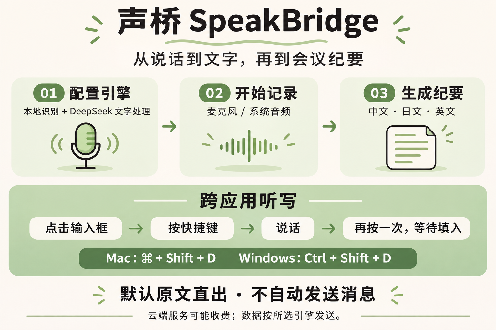

# 声桥 · SpeakBridge

面向 Windows 和 macOS 的独立桌面应用，提供实时语音转写、翻译、桌面字幕、会议纪要，以及向其他应用输入文字的本地听写。参照 Speakly 的使用场景实现，不是原版软件或 Typeless 的官方分支。

**[文档索引](docs/README.md) · [开始使用](docs/guides/getting-started.md) · [DeepSeek 配置](docs/guides/engines.md#deepseek-api) · [开发指南](docs/development.md)**

## 看看实际界面

点击下方播放，**1 分 54 秒**了解配置、会议纪要、跨应用听写、历史管理与配色。

https://github.com/user-attachments/assets/7f3f92f2-efd2-4878-82a8-e021296a3bf9

视频带中文字幕和点击提示。画面来自 0.7.11 界面，使用虚构资料及模拟服务；不代表真实 API 或原生输入验收。

[下载完整 MP4](docs/media/speakbridge-quickstart-zh.mp4) · [分章说明与字幕](docs/guides/video-tour.md)

<details>
<summary>查看功能与上手流程图</summary>



</details>

## 能做什么

- 采集麦克风、系统音频或两者混合，显示可修订转写与双语悬浮字幕。
- 按需使用本地 SenseVoice / Qwen3-ASR / Whisper，或兼容语音 API / Soniox；文字引擎独立配置。
- 用快捷键在普通输入框中听写，定稿后自动填入；可选文字整理，保留原文，不自动发送消息。
- 从会话生成中文、日文或英文纪要，按模型容量处理长资料，以 Markdown 表格和标题显示。
- 管理本地历史：搜索、收藏、重命名、逐条／多选／全选删除，以及 TXT、Markdown、SRT、Word、PDF 导出。
- [会议／区域录屏、滚动长截图、剪贴板历史、多快捷键与鼠标、屏幕文字问答及本地记忆](docs/guides/local-workspace.md)。
- 使用个人词典，切换五套配色或跟随系统；演示模式不录音、不调用 API。

## 当前版本与获取方式

源码版本 **0.8.0**。本仓库于 **2026-11-04** 公开，采用 MIT 许可证；尚未发布 GitHub Release 或安装包下载。本机打包结果与用户正在运行的应用不一定相同，详见[验证状态](docs/verification.md)。

支持目标：macOS 13+（Apple Silicon / Intel）、Windows 10 / 11 x64、Windows 11 ARM64（需 .NET Framework 4.8.1）。Mac 本机包使用 ad-hoc 签名，尚未公证；Windows 与 Intel Mac 的当前版本仍需实机验收。

从源码运行需要 Node.js 24、npm 和[原生构建依赖](docs/development.md#原生构建依赖)。Mac 也需要配置 Windows 输入组件的交叉编译环境，准备完成后：

```sh
npm ci
npm run dev
```

## 找到对应说明

| 目标 | 文档 |
| --- | --- |
| 首次录音、系统权限、字幕、配色 | [开始使用](docs/guides/getting-started.md) |
| DeepSeek、Ollama、Codex、Claude Code、Harness | [引擎与连接配置](docs/guides/engines.md) |
| 说完后自动填入输入框 | [跨应用听写](docs/guides/dictation.md) |
| 录屏、剪贴板、多快捷键、屏幕问答 | [本地工作空间](docs/guides/local-workspace.md) |
| 多语言纪要、长会议、历史删除 | [会议纪要与记录管理](docs/guides/meeting-notes.md) |
| 密钥、权限、无法输入或生成失败 | [故障排查](docs/guides/troubleshooting.md) |
| 数据去向、费用与本地保存 | [数据与隐私](docs/security.md) |
| 开发、打包、架构与验证 | [开发指南](docs/development.md) · [架构](docs/architecture.md) · [验证状态](docs/verification.md) |
| 版本变化、调研和旧测试 | [版本记录](CHANGELOG.md) · [历史归档](docs/archive/README.md) |

本地语音没有 API 调用费用；云端 API 与 CLI 可能消耗账户额度，CLI 不等于离线。会议文本在本机明文保存；未开启录屏音轨时原始音频不落盘；开启后音频随本地视频保存。选择云端识别时会发送音频，选择云端文字引擎时会发送相应转写。具体边界见数据与隐私文档。

## 许可与源码分享

项目采用 [MIT 许可证](LICENSE)。UI 使用 Lucide 图标及项目自有素材，原文表记见 [THIRD_PARTY_NOTICES.md](THIRD_PARTY_NOTICES.md) 和 [licenses](licenses)；语音模型、运行库及其他依赖适用各自条款，UI 清单不是全部依赖的许可证审计。

提交或分享前运行 `npm run check:sensitive` 并审查差异。不要提交 API Key、真实会议、个人配置、录音或本机测试产物。开发协作约定见 [AGENTS.md](AGENTS.md)。
