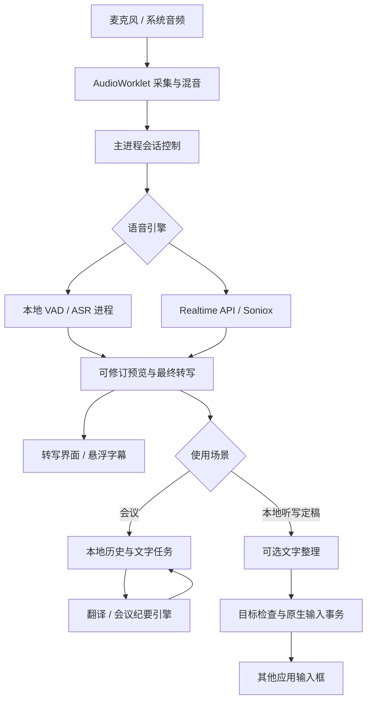

# 架构说明

[返回文档索引](README.md)

声桥使用 Electron 主进程管理窗口、权限、IPC 和生命周期，React 渲染器负责界面与音频采集。渲染器启用 sandbox / context isolation，没有直接 Node 权限；主进程校验 IPC 发送窗口及页面。

## 核心数据流

听写路径强制本地 ASR、仅麦克风、关闭翻译；图中的语音 API 分支只用于会议路径。预览可修改，只有最终文字进入后续翻译或听写交付。会议保存文本；听写保留本次内存结果，二者不是同一个历史存储流程。

## 模块分工

| 层 | 主要文件与职责 |
| --- | --- |
| 窗口与权限 | [main.cjs](../electron/main.cjs)、[preload.cjs](../electron/preload.cjs)：受控 IPC、主窗／字幕／听写 HUD／会议工具栏、会话和快捷键 |
| 采集与显示 | [audio.ts](../src/audio.ts)、[pcm-worklet.js](../public/pcm-worklet.js)：混音与 24 kHz PCM16；[LiveText.tsx](../src/LiveText.tsx)、[text-motion.ts](../src/text-motion.ts)：修订与逐字显示 |
| 本地语音 | [local-speech.cjs](../electron/local-speech.cjs)、[whisper-worker.cjs](../electron/whisper-worker.cjs)：任务队列与识别进程；[speech-segments.cjs](../electron/speech-segments.cjs)、[vad-worker.cjs](../electron/vad-worker.cjs)：VAD 与重叠分段 |
| 模型与复核 | [model-assets.cjs](../electron/model-assets.cjs)：下载和哈希校验；[transcript-consensus.cjs](../electron/transcript-consensus.cjs)：三路声学结果保守合并 |
| 外部服务 | [realtime.cjs](../electron/realtime.cjs)、[soniox.cjs](../electron/soniox.cjs)：语音协议；[providers.cjs](../electron/providers.cjs)、[deepseek.cjs](../electron/deepseek.cjs)：文字路由与 CLI |
| 听写交付 | [dictation.cjs](../electron/dictation.cjs)、[dictation-cleanup.cjs](../electron/dictation-cleanup.cjs)：定稿、整理、取消、单次交付与恢复；[Mac Swift](../native/dictation-mac.swift)、[Windows C#](../electron/native/dictation-win.cs)：原生目标检查和输入 |
| 纪要与历史 | [meeting-notes.cjs](../electron/meeting-notes.cjs)、[notes-models.cjs](../electron/notes-models.cjs)：提示词、语言、容量、分段；[history.cjs](../electron/history.cjs)：生成、删除、重试生命周期 |
| 存储与呈现 | [store.cjs](../electron/store.cjs)：原子写入、系统加密密钥；[MarkdownNotes.tsx](../src/MarkdownNotes.tsx)：受限 GFM 显示；[appearance.ts](../src/appearance.ts)：本机主题偏好 |

## 本地工作区扩展（0.8.0）

- `src/screen-recording.ts` 负责选择后的 MediaStream、区域 canvas、MP4 编码和有界分块写入；会议音频从现有混音分支借用，停止视频不销毁会议音轨。`electron/media.cjs` 管理本地索引、临时 `.part` 和范围读取协议。会话删除只解除媒体关联。
- `electron/shortcuts.cjs` 管理每动作最多三个绑定与失败回滚；原生 Swift / C# 监听独立修饰键和鼠标按钮。普通字母不被录屏按键显示收集。
- `electron/clipboard-history.cjs` 在明确启用后按系统计数检查变化，保留受限大小的原始剪贴板格式；跨应用粘贴复用原生目标、选区及密码框保护，不自动提交。
- `electron/screen-assistant.cjs` 启动可取消的 OCR utility process；`ocr-worker.cjs` 在本地提取文字。用户确认的文字与可选手动记忆才进入现有 TextRouter，不向模型发送图片。
- `electron/document-export.cjs` 将 Markdown AST 转成安全 HTML / DOCX，PDF 在隔离隐藏窗口打印。`electron/meeting-reminder.cjs` 只在启用后检测已知会议应用的麦克风活动，提示由用户确认录音。
- 录屏选择音频后会保存音轨，和原先纯转写的临时音频行为不同。媒体、剪贴板、问答、记忆、OCR 缓存可分别删除；此版本没有账号、云同步或上传服务。

## 必须保留的边界

- 本地 ASR 的可修订音频窗口与界面动画分开。视觉上连续出字不证明模型是原生流式，也不证明识别率提高。
- 音频任务、文字任务均有限制队列与收尾逻辑；发生错误应明确保留已完成文本，不能通过静默丢段或换服务维持“成功”。
- 听写目标探测与录音并行；最终交付等待定位完成。目标、选区、权限与密码框保护在原生层检查，不读取目标正文用于整理。
- 听写取消后的迟到结果不可写入；原生写入一旦开始，按事务收尾并恢复剪贴板。无法确认写入量时不能自动重复整段发送。
- 纪要完整成功后才替换旧内容；删除和取消要使后台旧结果失效，避免重新出现已删除记录。
- 转写和词典作为被引用数据传给文字引擎；模型输出仍是未受信任内容，不能执行 HTML、工具指令或任意导航。

配置行为见[引擎指南](guides/engines.md)，数据去向见[数据与隐私](security.md)，测试证据见[验证状态](verification.md)。
