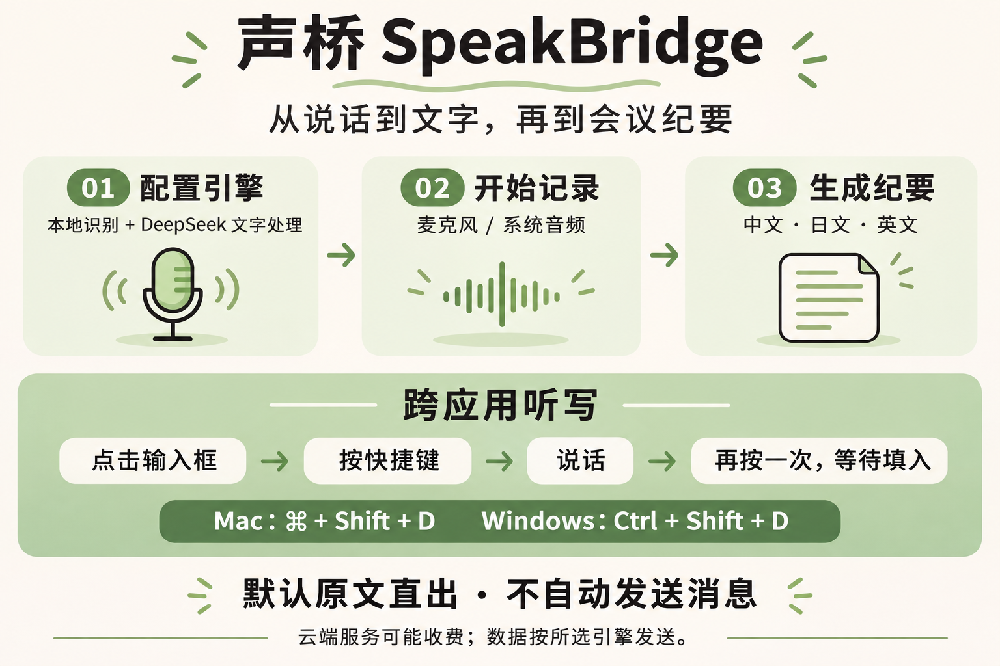

# 图片与视频上手指南

[返回文档索引](../README.md)

先看视频中的实际界面操作，再用流程图核对步骤。素材对应 **0.7.11**。

## 观看视频

https://github.com/user-attachments/assets/7f3f92f2-efd2-4878-82a8-e021296a3bf9

**[观看／下载中文上手视频（MP4）](../media/speakbridge-quickstart-zh.mp4)** · [本地播放页](../media/watch.html) · [SRT 字幕](../media/speakbridge-quickstart-zh.srt) · [VTT 字幕](../media/speakbridge-quickstart-zh.vtt)

视频约 **1 分 54 秒**，为 1920 × 1080、24 fps 的 H.264 MP4，带嵌入式中文字幕、点击提示和章节说明，**无配音、无背景音乐**。README 和本页使用 GitHub 附件播放器，可直接播放；仓库内保留相同的 MP4 供下载。克隆仓库后也可用浏览器打开 `docs/media/watch.html`，在本地按章节跳转。

| 时间 | 章节 | 看完后可以做什么 | 详细说明 |
| --- | --- | --- | --- |
| 00:05 | 配置 DeepSeek | 分开设置本地语音与云端文字，保存地址、模型与密钥 | [引擎配置](engines.md#deepseek-api) |
| 00:30 | 记录会议 | 选择音频和语言，开始、结束并等待保存 | [开始使用](getting-started.md) |
| 00:47 | 生成会议纪要 | 选择语言，生成后核对表格与行动项 | [会议纪要](meeting-notes.md) |
| 01:07 | 跨应用听写 | 点击输入框、按快捷键、说话、结束并检查结果 | [跨应用听写](dictation.md) |
| 01:31 | 管理历史 | 全选并确认删除范围，区分会话与纪要 | [记录管理](meeting-notes.md#历史记录与删除范围) |
| 01:42 | 配色与完成 | 切换主题，找到进一步的使用说明 | [文档索引](../README.md) |

<details>
<summary>查看功能与上手流程图</summary>



</details>

## 演示范围

视频使用项目当前 React 界面，数据与服务运行在独立的教程夹具中。会议文字、密钥输入、语音转写、模型响应、权限就绪状态和目标输入框结果均为虚构或模拟，画面持续标注此范围。跨应用片段使用示例编辑器与真实 HUD 组件展示流程，**不是对某个目标应用的原生输入兼容性实测**。

制作期间没有读取真实会议或凭据，没有录制真实麦克风，没有调用 DeepSeek、Codex 或其他模型服务，也没有改变用户安装的声桥。录制耗时不能用来判断模型延迟或识别准确率。实际使用仍需完成权限和连接检查，平台验收范围见[验证状态](../verification.md)。

流程图中的“本地识别 + DeepSeek”是一种配置示例，不是唯一组合。默认听写原文直出不调用文字模型；云端识别、翻译、纪要或可选整理可能发送相应资料并消耗服务额度，详见[数据与隐私](../security.md)。

## 素材来源与维护

- 流程图使用内置 imagegen 生成；完整提示词保存在 [image-prompt.txt](../../scripts/media/image-prompt.txt)，未引用原版截图或品牌资产。
- 视频沿用现有 html-video 技能的 HTML → Chromium → ffmpeg 制作流程，使用仓库内独立脚本，不依赖该技能的外部 CLI。真实产品界面没有因录制而修改。
- 应用图标来自项目 [icon.svg](../../build/icon.svg)，界面图标仍为 Lucide；许可见[素材表记](../../THIRD_PARTY_NOTICES.md)。使用系统字体渲染，不分发字体文件。
- 不使用第三方音乐、声音、视频片段或新增图标素材。图片和视频用于项目文档，输入样例均为虚构内容。
- 编码信息、章节时间及验证摘要见[视频清单](../media/video-manifest.json)，文件哈希见[素材完整性清单](../media/SHA256SUMS.txt)。

更新界面后，在已安装项目 npm 依赖、可运行 Chromium 与 ffmpeg 的开发环境执行：

```sh
# 快速检查所有场景，结果只写入 test-artifacts/
node scripts/media/render.cjs --fast

# 按正常速度录制并输出 MP4、SRT、VTT 和清单
node scripts/media/render.cjs

# 更新播放页、视频封面与素材哈希
node scripts/media/package.cjs
```

GitHub 内嵌播放器使用单独上传的附件，不会随仓库内 MP4 自动更新。更换视频后，在 GitHub 的 Markdown 编辑器上传新的 MP4，并同步替换 README 和本页中独占一段的 `github.com/user-attachments/assets/…` 地址；提交前用预览确认可播放和跳转。不要把临时签名的媒体下载地址写入文档。

录制使用本地 Vite、无头 Chromium 和内存夹具，屏蔽外部 HTTP 请求；不会启动已安装的桌面应用或执行原生输入。复用已安装依赖时不需要运行应用的原生构建。制作源文件在 [scripts/media](../../scripts/media)，中间录屏与检查图保留在被 Git 排除的 `test-artifacts/onboarding-media/`。更新正式素材后应再次检查文字、画面、字幕时序和可播放性。
